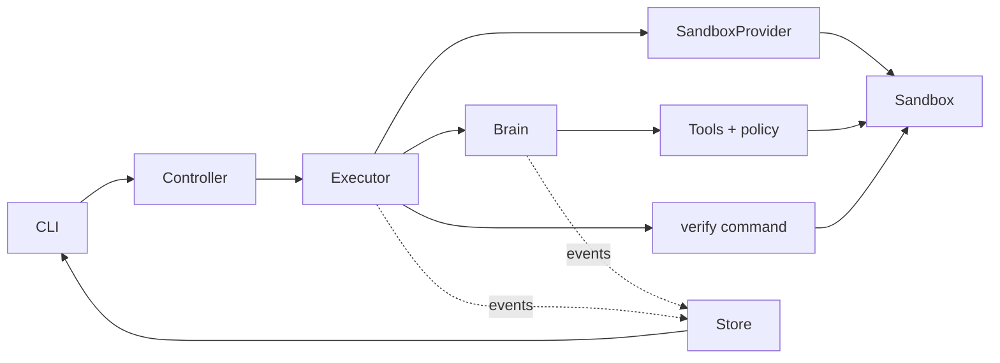

# Architecture

## A run

1. `Controller.submit` validates the spec and creates the run (`queued`).
2. The executor moves it to `running` and asks the provider for a sandbox. Setup has network; when setup finishes the
   container is disconnected.
3. `Brain.run` loops: call the model, run the requested tools inside the sandbox, send results back, until the model
   calls `submit`, a limit is hit, or the run is canceled.
4. The executor runs the verify command itself. Exit code 0 means `completed`; anything else means `failed`.
5. The diff against the baseline commit is stored with the result, and the sandbox is destroyed in a `finally` block.

Each step emits a `RunEvent` (`{ runId, seq, ts, type, data }`). The store keeps them append-only; `nanogent show` and,
later, the web UI only read events.

## Notes

- `core` has no runtime dependencies on other packages; `config` depends on `core` only.
- Strings in events are passed through `redact()` before they are written.
- Usage is tracked as four separate buckets (input, output, cache read, cache write) and priced once each.
- Budget limits are cumulative and checked with `>=`; per-command limits (timeout, output bytes) are enforced while the
  command runs.
- Run ids sort by creation time within a process.
- The model client is injected. Tests pass a fake that replays scripted SDK messages.
