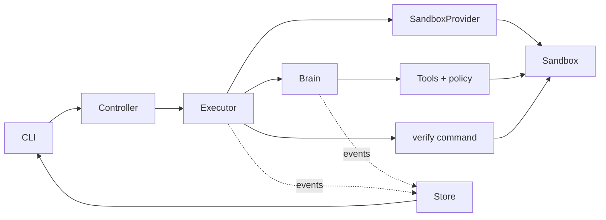
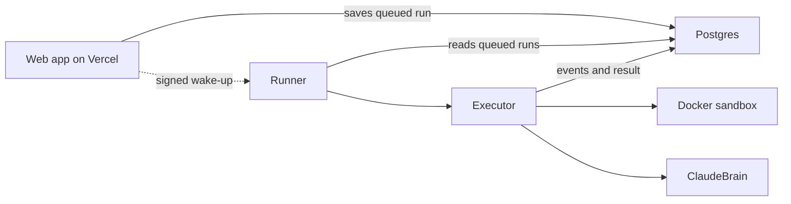

# Architecture

## A run

1. `Controller.submit` validates the spec and creates the run (`queued`).
2. The executor moves it to `running` and asks the provider for a sandbox. Setup has network; when setup finishes the
   container is disconnected.
3. `Brain.run` loops: call the model, run the requested tools inside the sandbox, send results back, until the model
   calls `submit`, a limit is hit, or the run is canceled.
4. The executor runs the verify command itself. Exit code 0 means `completed`; anything else means `failed`.
5. The diff against the baseline commit is stored with the result, and the sandbox is destroyed in a `finally` block.

Each step emits a `RunEvent` (`{ runId, seq, ts, type, data }`). The store keeps them append-only; `nanogent show` and,
later, the web UI only read events.

## Notes

- `core` has no runtime dependencies on other packages; `config` depends on `core` only.
- Strings in events are passed through `redact()` before they are written.
- Usage is tracked as four separate buckets (input, output, cache read, cache write) and priced once each.
- Budget limits are cumulative and checked with `>=`; per-command limits (timeout, output bytes) are enforced while the
  command runs.
- Run ids sort by creation time within a process.
- The model client is injected. Tests pass a fake that replays scripted SDK messages.

## Hosted execution

`RemoteController.submit` validates the spec, writes the run and its creation event, and sends the runner a wake-up. The
saved `queued` row is the queue entry. If the wake-up is lost, the runner finds the row on its next sweep.

`PostgresRunStore` uses Drizzle with a caller-supplied Postgres database. The runner uses node-postgres. A web server can
supply Drizzle's Neon serverless WebSocket driver, which supports interactive transactions; the HTTP driver does not.
The `public.runs.owner_id` column is a nullable UUID matching Neon Auth IDs, without a cross-schema foreign key.
`list({ ownerId, limit })` orders newest first. Event replay uses 100-row pages and a fixed upper sequence bound.

Each append locks the run row with `SELECT ... FOR UPDATE`, checks the sequence and state, and commits the event with
its corresponding row update. The composite event primary key also prevents duplicates. `finish` persists the result
and terminal transition in one transaction. Specs, event data and results are redacted before storage.

The runner (`apps/worker`) is one long-running process. It keeps up to `NANOGENT_CONCURRENCY` runs going (default 2,
sized for a 2-core, 12 GB host) and looks for work when woken, every 5 seconds while busy, and every 15 minutes when idle.
Polling is kept slow on purpose: a constant poll would keep a scale-to-zero database awake. The wake-up endpoint
(`POST /wake`) checks an HMAC signature over a timestamp and the body, allows a minute of clock skew, caps body size and
accepts at most five wake-ups a second.

`executeStoredRun` takes a Postgres advisory transaction lock for the duration of execution. A second live delivery
returns without work. Once a crashed connection releases the lock, a replacement sees the active state and records a
failure, preserving usage already recorded in events. Terminal runs are unchanged. The runner does not resume a paid
model loop. Each live run holds one connection for the lock and uses another for short event transactions; the pool
allows 24 connections. Do not configure an idle-transaction timeout shorter than a run on the lock connection.

There is one attempt per run. Only classified transient sandbox setup failures (Daytona 429, 502, 503, 504) are retried,
before the model starts and after any allocated sandbox is cleaned up. Verification failures and model failures are final.

Cancellation is persisted first. Queued runs become canceled immediately. For an active run the runner sees the flag
within a fraction of a second and aborts the executor, which destroys the sandbox in `finally`. On `SIGTERM` the runner
stops taking runs and gives current ones `NANOGENT_DRAIN_SEC` (default 300) to finish before cancelling them. A hard kill
can leave a sandbox container behind; `nanogent gc` removes old labelled ones. See [security](security.md) for sandbox
isolation and [worker setup](../apps/worker/README.md) for configuration.

## Web dashboard

`apps/web` serves the App Router dashboard and owner-scoped run API. Neon Auth's Next.js SDK handles email/password, GitHub and Google
sign-in and the auth proxy. Server pages and run handlers independently validate the session; the UUID user ID is the
only source of `owner_id`. Reads and cancellations check ownership before using the backend. Unowned and missing IDs
both return 404. Database and auth modules are marked `server-only`.

Each web request opens a small Neon serverless WebSocket pool and passes its Drizzle database to `PostgresRunStore`.
The pool closes in `finally`, including after failures. HTTP-only Neon connections cannot supply the store's interactive
transactions. The remote controller entry point avoids importing the local executor into the web runtime.

Submission validates bounded input, public HTTPS git hosts, configured models and a server-side cost ceiling. An owner
advisory lock spans admission and `RemoteController.submit`, serializing competing web instances. All active budgets
remain reserved; terminal recorded costs count on their UTC completion day. This enforces three active runs and the
configured daily admission budget without relying on the limited dashboard list. Saved runs survive ambiguous enqueue
failures, keep their reservation, and return their ID for review, cancellation or operator reconciliation.

The browser polls `GET /api/runs/[id]/events?from=N`, where N is inclusive. Responses contain at most 100 events,
`nextSeq`, and `hasMore`. The view reloads the current run first, drains event pages, and stops after it has observed a
terminal state and exhausted the events. Failed polls retry from the last successful cursor. PostgreSQL supplies state,
usage and final results. The timeline groups calls and results by tool call ID, uses event sequences for row identity
and shows usage from model responses. The verification panel uses the harness event as soon as it arrives.

The run view accepts an optional `diffSnapshot` on the run API response. The production backend currently provides
the final patch through the run result. The viewer parses the patch in the browser and renders code and terminal
spans as text. The diff viewer and syntax highlighter load separately. Plain text renders first, then Shiki loads the
matching language and tokenizes in idle batches. Patch download retains the original data.

The signed-in shell shares one run list across its explorer, overview and command palette. `GET /api/runs` also returns
owner-scoped allowance data for the status bar. List polling runs every five seconds with active runs, thirty seconds
otherwise, and stops while hidden. Event polling also pauses while hidden, aborts stale requests, and resumes from the
last successful cursor. Editor tabs use guarded session storage; the explorer becomes a modal drawer on narrow screens.
Dark tokens and locally bundled fonts apply to all pages. OAuth providers come from validated server configuration;
return paths are restricted to same-origin relative paths, and provider secrets remain in Neon.

See [UI decisions](decisions/0007-web-ui.md), [web setup](../apps/web/README.md) and [ADR 0006](decisions/0006-web-and-auth.md) for deployment and quota details.

## GitHub projects

The GitHub App connection uses a separate OAuth flow after Neon sign-in. The OAuth cookie is short-lived and bound
to the session owner. The callback checks state and uses PKCE. Postgres stores encrypted user and refresh tokens per
owner. A row lock serializes refresh because GitHub rotates the refresh token. The browser receives repository metadata
and file data, and the runner never receives GitHub credentials.

The import catalog uses GitHub App user authorization, which covers repositories accessible to both the app and the
user. Import checks every selected repository again and stores its default branch and head commit in an owner-scoped
project row. The owner and repository ID make repeated imports idempotent. File browsing rechecks repository access
and reads the stored commit. Changing the project branch rechecks GitHub access, resolves the selected branch head,
and updates the branch and commit together. The update compares the previous pin to catch changes from another tab.
Previously submitted runs retain their original commit in their run spec. The dashboard renders bounded text previews
as plain text. Disconnect removes the connection and keeps project records. A session started from a public project
uses its pinned commit and stores the project ID on the run. Submission rechecks the signed-in user's GitHub
repository access. Private projects support file browsing.

Named sessions belong to a project and retain their starting branch and commit. Each associated run adds a request
and result to that session's history. The web API checks project ownership and GitHub access and serializes
admission per owner. A partial unique index enforces one active run per session. Follow-ups save a bounded snapshot
of recent completed tasks and their written results in the run spec. The executor passes those turns to the model
and supplies only the existing checkout fields to the sandbox. The header keeps open tabs in per-account browser
session storage. The project page can reopen a saved session after its tab has closed.
