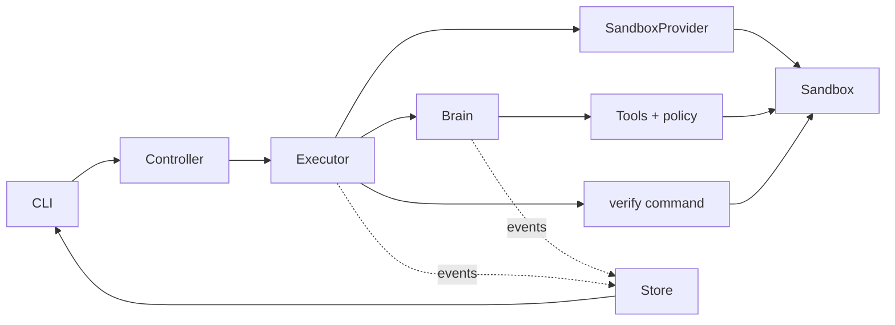
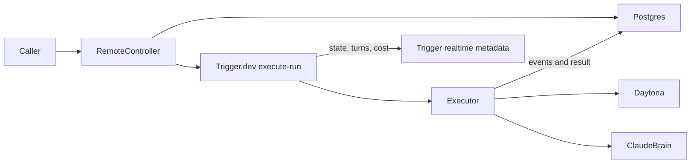

# Architecture

## A run

1. `Controller.submit` validates the spec and creates the run (`queued`).
2. The executor moves it to `running` and asks the provider for a sandbox. Setup has network; when setup finishes the
   container is disconnected.
3. `Brain.run` loops: call the model, run the requested tools inside the sandbox, send results back, until the model
   calls `submit`, a limit is hit, or the run is canceled.
4. The executor runs the verify command itself. Exit code 0 means `completed`; anything else means `failed`.
5. The diff against the baseline commit is stored with the result, and the sandbox is destroyed in a `finally` block.

Each step emits a `RunEvent` (`{ runId, seq, ts, type, data }`). The store keeps them append-only; `nanogent show` and,
later, the web UI only read events.

## Notes

- `core` has no runtime dependencies on other packages; `config` depends on `core` only.
- Strings in events are passed through `redact()` before they are written.
- Usage is tracked as four separate buckets (input, output, cache read, cache write) and priced once each.
- Budget limits are cumulative and checked with `>=`; per-command limits (timeout, output bytes) are enforced while the
  command runs.
- Run ids sort by creation time within a process.
- The model client is injected. Tests pass a fake that replays scripted SDK messages.

## Hosted execution

`RemoteController.submit` creates a run and its creation event, then triggers `execute-run` with the run ID as the
idempotency key. The Trigger run ID and cancellation request are persisted on the run. If enqueueing fails after a
network timeout, `enqueue(runId)` repeats the same request without creating another row. An authorized caller must
check ownership before reading, enqueueing or canceling a run; these backend classes do not implement authentication.

`PostgresRunStore` uses Drizzle with a caller-supplied Postgres database. The worker uses node-postgres. A web server can
supply Drizzle's Neon serverless WebSocket driver, which supports interactive transactions; the HTTP driver does not.
The `public.runs.owner_id` column is a nullable UUID matching Neon Auth IDs, without a cross-schema foreign key.
`list({ ownerId, limit })` orders newest first. Event replay uses 100-row pages and a fixed upper sequence bound.

Each append locks the run row with `SELECT ... FOR UPDATE`, checks the sequence and state, and commits the event with
its corresponding row update. The composite event primary key also prevents duplicates. `finish` persists the result
and terminal transition in one transaction. Specs, event data and results are redacted before storage.

`executeStoredRun` takes a Postgres advisory transaction lock for the duration of execution. A second live delivery
returns without work. Once a crashed connection releases the lock, a replacement sees the active state and records a
failure, preserving usage already recorded in events. Terminal runs are unchanged. The worker does not resume a paid
model loop. Each live run holds one connection for the lock and uses another for short event transactions; the pool
allows 24 connections and the task queue limits concurrency to 10. Keep those settings aligned when scaling, and do not
configure an idle-transaction timeout shorter than a run on the lock connection.

The task has one attempt. Only classified transient sandbox setup failures (429, 502, 503, 504) get up to two retries,
before the model starts and after any allocated sandbox is cleaned up. Verification failures and model failures are
final. Progress metadata contains state, turns and cost; Postgres is authoritative if metadata delivery fails.

Cancellation is persisted before `runs.cancel`. Queued runs become canceled immediately. Active workers observe the
flag and Trigger's abort signal; the executor destroys the sandbox in `finally`. The task's `onCancel` hook waits for
cleanup. Trigger allows a limited cleanup window, so a worker killed during creation or teardown can still leave a
sandbox until Daytona's lifecycle limits or GC remove it. See [security](security.md) for the network exception and
[worker setup](../apps/worker/README.md) for runtime configuration.

## Web dashboard

`apps/web` serves the App Router dashboard and owner-scoped run API. Neon Auth's Next.js SDK handles email/password
sign-in and the auth proxy. Server pages and run handlers independently validate the session; the UUID user ID is the
only source of `owner_id`. Reads and cancellations check ownership before using the backend. Unowned and missing IDs
both return 404. Database, auth and Trigger modules are marked `server-only`.

Each web request opens a small Neon serverless WebSocket pool and passes its Drizzle database to `PostgresRunStore`.
The pool closes in `finally`, including after failures. HTTP-only Neon connections cannot supply the store's interactive
transactions. The remote controller entry point avoids importing the local executor into the web runtime.

Submission validates bounded input, public HTTPS git hosts, configured models and a server-side cost ceiling. An owner
advisory lock spans admission and `RemoteController.submit`, serializing competing web instances. All active budgets
remain reserved; terminal recorded costs count on their UTC completion day. This enforces three active runs and the
configured daily admission budget without relying on the limited dashboard list. Saved runs survive ambiguous enqueue
failures, keep their reservation, and return their ID for review, cancellation or operator reconciliation.

The browser polls `GET /api/runs/[id]/events?from=N`, where N is inclusive. Responses contain at most 100 events,
`nextSeq`, and `hasMore`. The view reloads the current run first, drains event pages, and stops after it has observed a
terminal state and exhausted the events. Failed polls retry from the last successful cursor. PostgreSQL supplies state,
usage and final results; no browser Trigger token is needed. Event payloads contain model usage rather than response
text. The timeline shows those costs and tool input/output, and the final diff is rendered as escaped text.

See [web setup](../apps/web/README.md) and [ADR 0006](decisions/0006-web-and-auth.md) for deployment and quota details.
